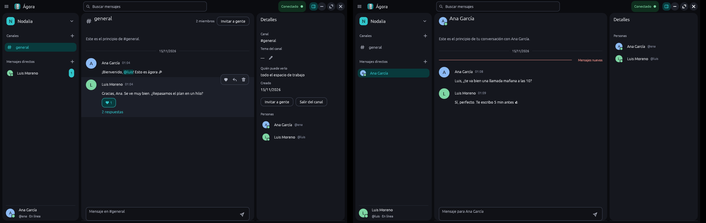
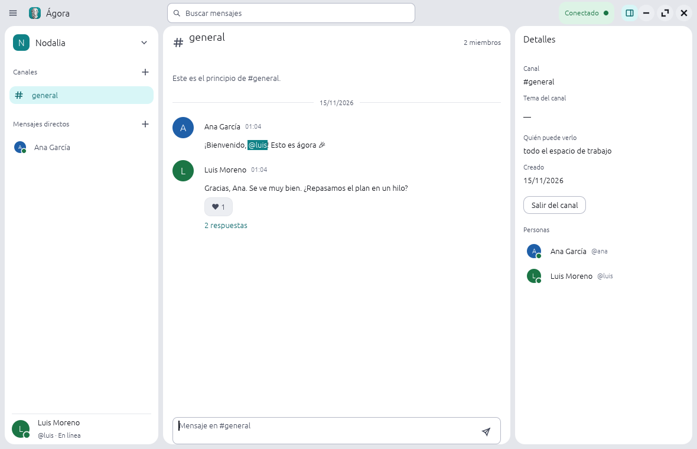

# Ágora

Ágora is open-source team chat you run yourself: workspaces, public and private channels, direct
messages, threads, reactions, mentions, unread markers and search, on your own server. The server
is one Rust binary with a SQLite file. The desktop client is native (egui, no web view) and drawn
in the [Nodalia Design Language](https://github.com/getnodalia/nodalia-design).

> **Status: early, first working version (0.1.0-dev).** Everything listed under "What works" is
> implemented and tested against a real server. Nothing has been released yet, and the protocol
> may still change before 1.0. There is **no end-to-end encryption**: the server can read every
> message, as in Slack, Teams or Discord. Use TLS for any server outside your own computer.



## What works

- **Accounts**: registration (open, by invitation or closed), sign-in, sign-out, sessions that
  expire, "keep me signed in" on the desktop.
- **Workspaces**: create, invite people with single- or multi-use codes that expire, join with a
  code, roles (owner, admin, member, guest). Workspaces are isolated from each other.
- **Channels**: public and private, topics, join and leave, archived channels are read-only.
- **Direct messages** between two people of a workspace.
- **Messages**: sent once even when the client retries (idempotent with a client nonce), edited,
  deleted, with reactions, `@mentions`, threads, and a small Markdown subset (bold, italic,
  strike, code, code blocks, quotes, links). Nothing is ever rendered as HTML.
- **Real time** over an authenticated WebSocket: new messages, edits, reactions, typing, presence,
  read markers across your devices; the client reconnects with backoff and catches up.
- **Unread counts and mentions** per channel and workspace, with a "New messages" line.
- **Search** in the messages you can read.
- **Desktop app**: three panes (workspaces and channels, the conversation, a details/thread/search
  panel), light, dark and high-contrast themes, reduced motion, keyboard shortcuts, Spanish and
  English, NDL window controls on Linux and native ones on macOS and Windows.



Not yet: file uploads, voice and video, notifications from the operating system, a web client,
mobile apps, PostgreSQL, federation, end-to-end encryption, installers. See [ROADMAP.md](ROADMAP.md).

## Run it

You need Rust 1.85 or newer. On Linux the desktop app also needs the usual windowing libraries
(Debian/Ubuntu: `sudo apt install libxkbcommon-dev libwayland-dev libgl1-mesa-dev libx11-dev libfontconfig1-dev`).

```sh
# The server, on http://127.0.0.1:7878 with ./agora.db
cargo run --release -p agora-server

# The desktop app (in another terminal)
cargo run --release -p agora-desktop
```

On the sign-in screen, the server is `localhost:7878`. The first account created on a server can
always register; it becomes the owner of the workspaces it creates. Copy
[`agora.example.toml`](agora.example.toml) to set the address, the database, who may register and
the limits, and start the server with `agora-server --config agora.toml`.

### Two people on one computer

Each desktop client keeps its settings and session in its own folder when `AGORA_DESKTOP_DIR`
is set, so two can run side by side:

```sh
cargo run --release -p agora-server                                  # terminal 1
AGORA_DESKTOP_DIR=/tmp/agora-ana  cargo run --release -p agora-desktop  # terminal 2
AGORA_DESKTOP_DIR=/tmp/agora-luis cargo run --release -p agora-desktop  # terminal 3
```

1. In the first window, choose **Create an account** (for example `ana`, with a password of your
   own, at least 10 characters), then **Create a workspace** from the empty screen.
2. Open **Invite people** in the channel header and copy the code.
3. In the second window, create a second account and paste the code in **Invitation code**; or
   create the account first and use **Join a workspace** from the workspace menu.
4. Write in `#general`: the other window shows it at once. Reply in a thread, react, open a direct
   message from **People** in the details panel, close a window and open it again: the history is
   still there. **Log out** is in the main menu (☰).

No password or account is stored in this repository; you choose them when you register.

## Repository

| Path | What |
|---|---|
| `crates/agora-core` | Ids, roles and permissions, limits, validation, the message text format |
| `crates/agora-protocol` | The HTTP and WebSocket contract (versioned under `/api/v1`) |
| `crates/agora-storage` | SQLite storage with migrations (SQLx) |
| `crates/agora-client` | The client library: HTTP calls and the real-time connection |
| `apps/agora-server` | The server (Tokio, Axum) |
| `apps/agora-desktop` | The desktop app (egui, nodalia-theme) |
| `docs/` | [Architecture](docs/architecture.md), [protocol](docs/protocol.md), [security](docs/security.md), [deployment](docs/deployment.md) |

```sh
cargo test --workspace          # unit tests and the end-to-end server tests
cargo clippy --workspace --all-targets -- -D warnings
```

## Security

Passwords are hashed with Argon2id, sessions are random tokens stored only as hashes, every
request and the WebSocket are authenticated, workspaces and private channels are checked on every
read and write, inputs are validated and size- and rate-limited, and queries are parameterised.
The server refuses to listen on a public address without TLS in front of it unless you say so.
[docs/security.md](docs/security.md) has the whole model and its limits, and
[SECURITY.md](SECURITY.md) how to report a vulnerability.

## Licence

`MIT OR Apache-2.0`, at your option ([LICENSE-MIT](LICENSE-MIT), [LICENSE-APACHE](LICENSE-APACHE)).
Assets and their sources are in [ATTRIBUTION.md](ATTRIBUTION.md).
